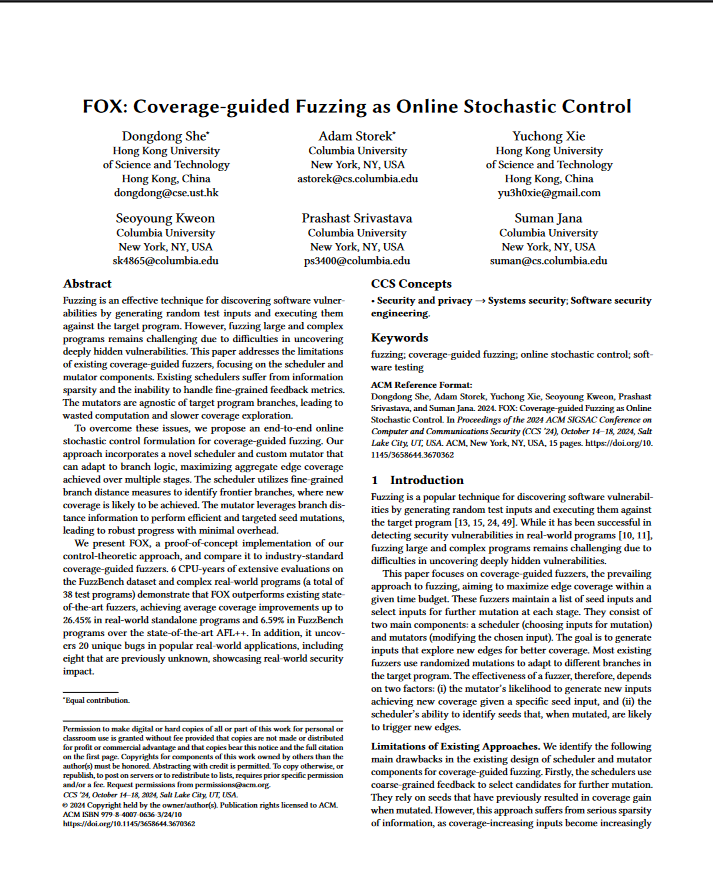

# FOX - Coverage-guided Fuzzing as Online Stochastic Control

<a href="https://arxiv.org/abs/2406.04517" target="_blank"></a>

FOX presents a control-theoretic approach to perform coverage-guided fuzzing. The current prototype is built on top of [AFL++](https://github.com/AFLplusplus/AFLplusplus/).
The key features implemented by FOX are:
- Custom scheduler logic: Scheduling is done over frontier branches instead of seeds.
- Custom mutator logic: Mutations adopt Newton's search method to synthesize branch-flipping inputs.
- Changes to the LLVM instrumentation pass to allow efficient branch distance calculation

This project is accepted at CCS'24 and will be presented there. Checkout our [paper](https://arxiv.org/abs/2406.04517) for more technical details about the project.
Refer to the instructions present in `artifact/` where we provide detailed instructions to reproduce our experimental results
and also detail instructions on how to run FOX on new targets.   
<br/>

# Usage
## Compilation Guide

The compilation process is similar to [AFL++](https://github.com/AFLplusplus/AFLplusplus). Here are the detailed steps:

### 1. Environment Preparation
First, clean up the environment by removing all contents in the shared memory folder:
```bash
rm -rf /dev/shm/*
```

### 2. Target Compilation
Compile the target program similarly to AFL++. For example, use the following commands to compile the program and libraries:
```bash
CC=/path/to/afl-clang-fast CXX=/path/to/afl-clang-fast++ ./configure --disable-shared
make clean all
```

### 3. File Organization
Copy the compiled binary and related metadata files to a clean folder:
```bash
cp [BIN_NAME] /path/to/clean/folder
cp /dev/shm/instrument_meta_data /path/to/clean/folder
```

### 4. Metadata Extraction
Use the Python script to extract metadata embedded in the compiled binary:
```bash
cd /path/to/clean/folder
python gen_graph_no_gllvm_15.py [BIN_NAME] [instrument_meta_data]
```
This script will generate several metadata files required for the fuzzing process.

### 5. Start Fuzzing
In the prepared folder, start FOX fuzzing by adding two parameters: `-k` and `-p wd_scheduler`:
```bash
/path/to/afl-fuzz -k -p wd_scheduler -i /path/to/seed -o /path/to/output -- [BIN_NAME] [BIN_PARAMETERS]
```

Notes:
- `[BIN_NAME]` is the name of your target program
- `[BIN_PARAMETERS]` are the parameters needed to run your target program
- `/path/to/seed` is the directory containing seed files
- `/path/to/output` is the directory for fuzzing results

## Concrete Example: Compiling FFmpeg

### AFL++ Compilation
```bash
# Navigate to FFmpeg source directory
cd ffmpeg-6.1

# Set necessary environment variables
export ASAN_OPTIONS=detect_leaks=0
export AFL_USE_ASAN=1
export CC=/workspace/AFLplusplus/afl-clang-fast
export CXX=/workspace/AFLplusplus/afl-clang-fast++

# Create build directory
mkdir -p ../binaries/aflpp_build

# Configure and compile
./configure --pkg-config-flags="--static" --cc=$CC --cxx=$CXX --disable-stripping
make -j$(nproc) clean
make -j$(nproc)

# Copy the compiled binary
cp ffmpeg ../binaries/aflpp_build
```

### FOX Compilation
```bash
# Navigate to FFmpeg source directory
cd ffmpeg-6.1

# Set necessary environment variables
export AFL_USE_ASAN=1
export ASAN_OPTIONS=detect_leaks=0
export CC=/workspace/FOX/afl-clang-fast
export CXX=/workspace/FOX/afl-clang-fast++

# Prepare build directory and clean shared memory
rm -rf ../binaries/fox_build
mkdir -p ../binaries/fox_build
rm -f /dev/shm/*

# Configure and compile
./configure --pkg-config-flags="--static" --cc=$CC --cxx=$CXX --disable-stripping
make -j clean
make -j$(nproc)

# Copy necessary files
cp ffmpeg ../binaries/fox_build
cp /dev/shm/instrument_meta_data ../binaries/fox_build

# Generate auxiliary files
cd ../binaries/fox_build/
python /workspace/FOX/gen_graph_no_gllvm_15.py $BIN_NAME $PWD/instrument_meta_data
```

## Additional Dependency

```bash
pip3 install pyelftools==0.30
```

> **🔔 IMPORTANT NOTE:** Unlike traditional approaches, our solution DOES NOT require GLLVM or WLLVM to obtain compilation-time information. This makes our tool more versatile and widely applicable across different compilation environments!

The above dependency is required for our Python scripts to parse and analyze ELF binaries.

# Cite
```bibtex 
@inproceedings{she2024fox,
  title={FOX: Coverage-guided Fuzzing as Online Stochastic Control},
  author={She, Dongdong and Storek, Adam and Xie, Yuchong and Kweon, Seoyoung and Srivastava, Prashast and Jana, Suman},
  booktitle={Proceedings of the 2024 ACM SIGSAC Conference on Computer and Communications Security},
  year={2024}
}
```
